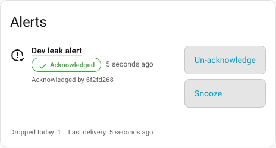
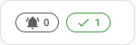
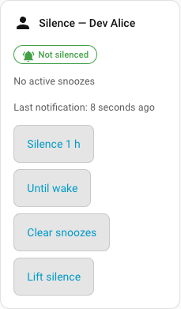
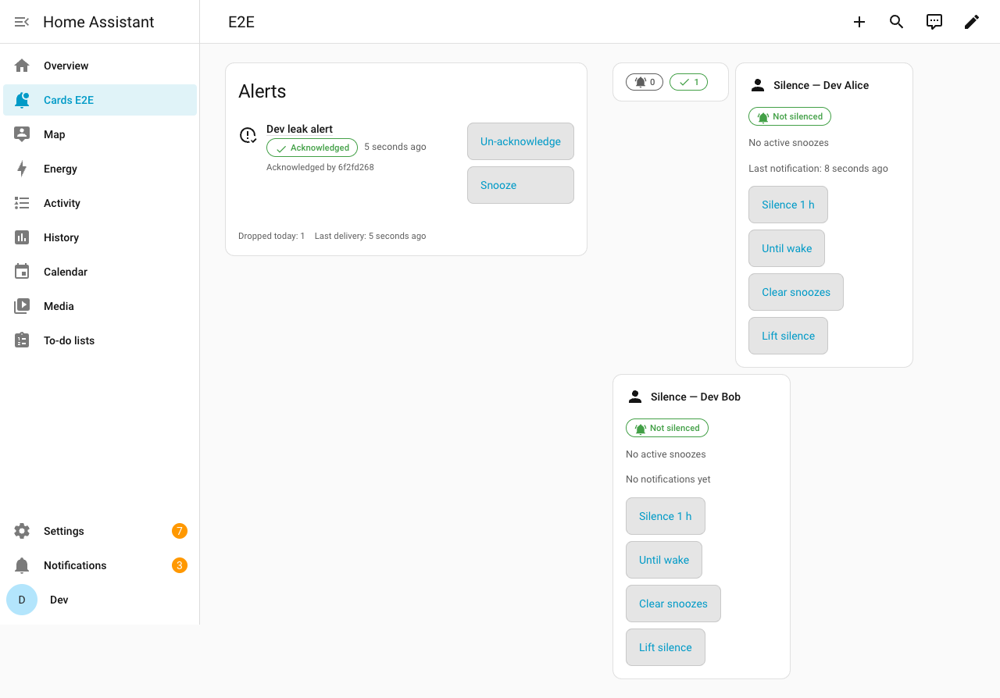
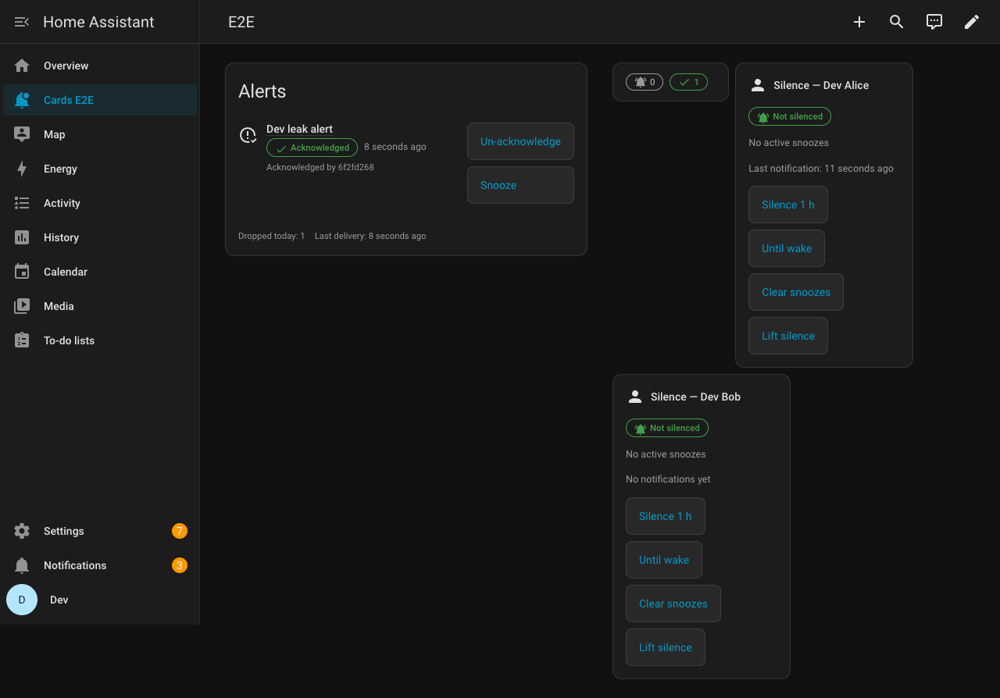
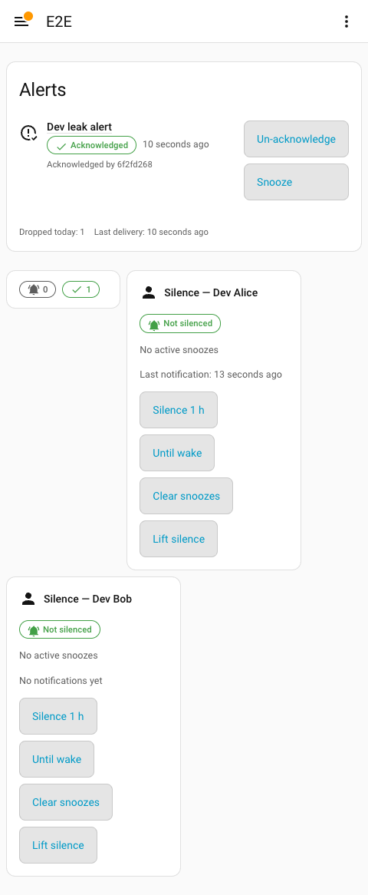

# Dashboard cards

Notify Switchboard comes with two dashboard cards. They read and act on
`alert.*` entities and the integration's own entities and actions.

Two cards are included:

- **`switchboard-alerts-card`** — lists `alert.*` entities, with
  acknowledge / un-acknowledge / snooze actions. Can render inline (`full`)
  or as a compact badge that opens a dialog (`compact`).
- **`switchboard-silence-tile`** — shows one person's silence state
  (`binary_sensor.<person>_silenced`, active snoozes, last notification)
  with silence / clear controls.

## Screenshots

| | |
|---|---|
|  | `switchboard-alerts-card`, `mode: full`, with one active alert |
|  | `switchboard-alerts-card`, `mode: compact` |
|  | `switchboard-silence-tile` for a person with no active silence |
|  | Full dashboard — light theme |
|  | Full dashboard — dark theme |
|  | Full dashboard — mobile viewport (480px) |

Captured against a real Home Assistant 2026.9 instance with
`cards/scripts/screenshots.mjs` (see [CONTRIBUTING.md](../CONTRIBUTING.md)).

## What the cards read

The cards read native `alert.*` entities and the per-person entities of the
[contract](contract.md): `binary_sensor.<person>_silenced`,
`sensor.<person>_active_snoozes` and `sensor.<person>_last_notification`.
Both read `sensor.switchboard_routing_table` to find each alert's target,
its snooze durations and each person's wake time, so you do not restate
them in the card. The alerts card adds a small "today" footer when
`sensor.switchboard_dropped_today` and `event.switchboard_delivery` exist.

Every action checks that the `notify_switchboard.*` action exists before
calling it. While Notify Switchboard is not loaded, acknowledging falls back
to `alert.turn_off` and the buttons that need it are shown disabled, with
the reason.

## Installation

Nothing to install: the cards come with the integration. When Notify
Switchboard starts, it serves them and adds them to your dashboards'
resources (**Settings → Dashboards → ⋮ → Resources**,
`/notify_switchboard/notify-switchboard-cards.js`). If your resources are
written in YAML (`lovelace:` with `resource_mode: yaml`), the integration
cannot edit them and loads the cards on every page instead. Either way, add
a card from the dashboard editor: search for "Notify Switchboard".

After an upgrade, refresh the page once so the browser picks up the new
version. The resource is Notify Switchboard's: deleted by hand, it comes
back at the next start; to stop loading the cards, remove the integration.

### Coming from the separate card repository

Up to 0.9.0 the cards were a separate HACS download,
`amiel-35/notify-switchboard-cards`. Remove it from HACS once you are on
0.10.0: as long as its resource
(`/hacsfiles/notify-switchboard-cards/…`) is loaded, the browser may use the
old copy, and Notify Switchboard raises a repair to say so. Your card
configurations need no change: the card types are the same.

## Usage
## Usage

### `switchboard-alerts-card`

```yaml
type: custom:switchboard-alerts-card
title: Alerts
mode: full # or "compact"
show_acknowledged: true
entities:
  - alert.leak_kitchen
  - alert.door_left_open
# Every option below is optional.
target_map:
  alert.leak_kitchen: leak
snooze_minutes: [15, 60, 480]
person: person.alice
person_picker: false
```

- `entities` — list of `alert.*` entity ids. Defaults to every `alert.*`
  entity in Home Assistant when omitted.
- `mode` — `full` renders the list inline; `compact` renders a badge with
  the active/acknowledged/unavailable counts that opens a dialog on
  activation. In compact mode the badge shows **chips only** by default —
  `title` is not rendered on the badge itself unless explicitly
  configured, since a narrow sections column rarely has room for both a
  title and the count chips. When `title` is set, it is shown as a
  single, non-wrapping line (ellipsized if the column is too narrow) so
  it can never wrap letter by letter; the dialog opened from the badge
  always shows the title regardless of this setting.
- `show_acknowledged` — whether acknowledged (`off`-state) alerts are
  listed alongside active ones. Idle alerts are never listed; unavailable
  ones always are.
- `target_map` — **optional.** Maps an `alert.*` entity
  to its Notify Switchboard target slug (the `notify.switchboard_<slug>`
  row), so Acknowledge can call `notify_switchboard.acknowledge` and the
  Snooze menu can appear. The card reads that mapping
  out of `sensor.switchboard_routing_table` (each target's
  `alert_entity`), so you only need this option to override the router or
  to map an alert it does not own. Without a mapping from either source,
  Acknowledge falls back to `alert.turn_off` and Snooze never appears for
  that entity. Acknowledge also falls back to `alert.turn_off` for a
  routing-table row that has no `alert_entity` of its own, which is
  exactly when `notify_switchboard.acknowledge` would refuse the call.
- `snooze_minutes` — **optional.** Durations (positive
  whole minutes) offered in the snooze menu. Left unset, each target's own
  `snooze_minutes` from the routing table is used, falling back to
  `[15, 60, 480]` only when the routing table holds no row for that alert.
  Set, it applies to every target on the card — so if your card already
  carries `snooze_minutes: [15, 60, 480]` from an earlier version, **delete
  the option** to pick up each target's own durations instead. Where the
  routing table describes the target, the option can only **narrow** that
  target's own list: the router refuses any duration it does not offer
  (`snooze_minutes_not_offered`), so a duration the router would refuse is
  never shown. A target the routing table publishes with an empty
  `snooze_minutes` has snooze switched off entirely, and the card shows no
  snooze menu on that alert at all — nor does one appear when the option
  and the target's list have no duration in common.
- `person` — optional `person.*` entity the snooze applies to. **Without
  it, `notify_switchboard.snooze` snoozes the target for the whole
  audience**, and the menu says so ("Snooze for everyone · 15 min"). The
  option is also dropped, and that audience-wide snooze used instead,
  when the routing table's audience for that target does not name this
  person: the router would refuse the call (`person_not_in_audience`), so
  **a name the router would refuse is never sent** — by this option or by
  the picker below. The menu stays: an audience-wide snooze is still
  worth offering, and its label says which one it is.
- `person_picker` — `true` turns Snooze into two steps on the card
  itself: who, then how long. The chooser lists the persons the routing
  table publishes (named from their `person.*` state) plus an explicit
  "Everyone", and what you pick is the `person` passed to
  `notify_switchboard.snooze` for that one call — it overrides the
  `person` option and is forgotten when the menu closes, which it does on
  its own as soon as a duration is picked. Only the persons of **that
  target's own audience** are offered: the router refuses a snooze for
  anybody else, so a name it would refuse is never shown. Intended for a
  shared wall tablet, where the card has no idea who is standing in front
  of it. Acknowledge never asks: the router reads the acting user from the
  call's own context. Defaults to `false`, and never appears when the
  target's audience names no person (an audience of bare `notify.*`
  outputs).

Every option is validated in `setConfig`: a bad shape (for instance
`entities: alert.leak` as a bare string, or `mode: tiny`) produces a
Lovelace error card naming the offending option rather than a card that
renders wrong or throws mid-render.

Alert entities in `unavailable` or `unknown` are shown as a distinct
fourth state — a neutral "Unavailable" chip with a `mdi:help-circle-outline`
icon and no actions. They are never counted or styled as acknowledged.

An acknowledged alert also shows **"Acknowledged by …"** when the router
says who did it. Authorship lives in the `acknowledged`
payload of `event.switchboard_delivery` and nowhere else — no sensor, no
stored record — and a Home Assistant event entity keeps only its **last**
event. So the line is shown while the last delivery event is this target's
acknowledgement, and disappears as soon as any later routing event
replaces it. It also disappears when the alert itself has changed since
that event — an alert that fired again is a new one nobody has
acknowledged yet, and the earlier acknowledger is not credited with it.
When the router could not resolve the acting user to a `person.*`, a
shortened user id is shown rather than a guess; when it knows neither,
nothing is shown.

Clicking an alert's name opens Home Assistant's more-info dialog for it.

### `switchboard-silence-tile`

```yaml
type: custom:switchboard-silence-tile
person: person.alice
wake_time: "07:00"
title: Alice
```

- `person` — a `person.*` entity. The tile derives
  `binary_sensor.<object_id>_silenced`, `sensor.<object_id>_active_snoozes`
  and `sensor.<object_id>_last_notification` from it.
- `wake_time` — **optional.** 24h `HH:MM`, used by
  "Until wake" to compute how many minutes to silence for. Left unset, the
  tile reads this person's own `wake_time` from
  `sensor.switchboard_routing_table` (the router publishes it as
  `HH:MM:SS`), falling back to `07:00` when neither is available. Computed
  on the **Home Assistant instance's** clock (`hass.config.time_zone`),
  not the browser's.

The tile's four controls map one-to-one onto router services: "Silence 1 h"
and "Until wake" call `notify_switchboard.silence`, "Clear snoozes" calls
`notify_switchboard.unsnooze`, and "Lift silence" calls
`notify_switchboard.unsilence`. No call is synthesised out of another
service.

## Accessibility

Both cards keep every interactive control at a 48px minimum touch target,
show a visible focus outline, expose `aria-label`s, wrap text instead of
truncating it (verified at 200% browser zoom), never rely on color alone
for state (every chip carries text *and* an icon), and skip non-essential
motion when `prefers-reduced-motion: reduce` is set.

The compact badge's dialog traps focus: Tab and Shift+Tab cycle inside it,
and Escape closes it and returns focus to the badge button. Controls that
cannot act (because the router service is missing) are `aria-disabled`
rather than `disabled`, so they stay reachable and the reason is announced.


## Development

The sources live in [`cards/`](../cards); the build lands in
`custom_components/notify_switchboard/www/` and is committed, because it is
what the release ships.

```bash
cd cards
npm install
npm run dev        # rebuilds the bundle on change
npm run lint
npm run format:check
npm run typecheck
npm test
npm run build      # custom_components/notify_switchboard/www/notify-switchboard-cards.js (+ .js.map)
npm run size       # bundle size budget check (<= 60 kB gzip)
```

## License

[MIT](../LICENSE), like the rest of the integration.
